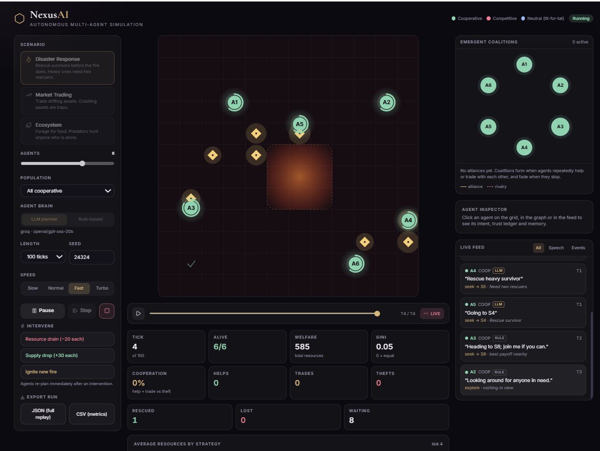
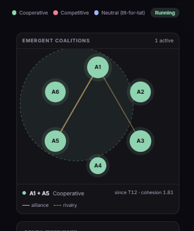

# NexusAI

**Autonomous multi-agent simulation where cooperation, rivalry and coalitions emerge on their own.**


## Overview

NexusAI drops up to eight autonomous agents with distinct personalities into a shared world (a disaster zone, a trading market or a predator-filled ecosystem) and watches what they do. Agents gather, help, trade, steal and form alliances, and the system detects the coalitions that emerge without being programmed. It runs entirely on free tiers: an LLM can plan for the agents, and a rule-based brain takes over automatically when no API key is present or a quota is hit.

## Features

- **Dual-process agents.** A slow LLM planner sets each agent's intent every few ticks in a single batched call. A fast rule controller executes it every tick, with reflexes such as fleeing fire.
- **Free-tier safe.** RPM/TPM budgeting, bounded retries, a circuit breaker and silent fallback to rules mean quota limits never crash a run.
- **Real game theory.** Mutual trade is positive-sum, theft destroys value and costs reputation, contested nodes are hawk-dove games, and heavy survivors need two rescuers (a coordination game).
- **Emergent coalitions.** Decaying alliance and rivalry edges are clustered into groups, with formed, reshaped and dissolved events.
- **Three scenarios.** Disaster response, market trading (with trend traps) and ecosystem survival.
- **Live control.** Pause, step, change speed and intervene (resource drain, supply drop, scenario crisis) while the run is going.
- **Replay and export.** Scrub through history, inspect any agent's trust ledger, and export JSON or CSV.
- **Deterministic.** The same seed always produces the same run.
- **Prompt-injection aware.** Messages agents hear from each other are marked untrusted, sanitised and truncated.

## Tech Stack

| Layer | Tools |
| --- | --- |
| Simulation | Python 3.11–3.13, pure standard library engine |
| API | FastAPI, WebSockets, httpx |
| LLM providers | Groq, Gemini, OpenRouter (free tiers), Anthropic (optional) |
| Frontend | React 19, Vite, Tailwind CSS v4, lucide-react, canvas and SVG charts |
| Testing | pytest (53 tests) |
| Deploy | Vercel (frontend), Render / Railway / Fly (backend) |

## Screenshots / Demo


*Live dashboard: 6 agents, 100 ticks, Groq LLM planner (seed 24324).*


*Alliances detected from repeated help and trade, grouped into a coalition.*


*End-of-run metrics: survivors, welfare, Gini and cooperation.*


*Average resources by strategy, and cooperation versus inequality across 100 ticks.*

## Installation

Requires Python 3.11–3.13 and Node 20+.

```bash
# Backend
cd backend
python -m venv venv
source venv/bin/activate        # Windows: venv\Scripts\activate
pip install -r requirements-dev.txt
cp .env.example .env            # optional: add one free API key
uvicorn main:app --reload --port 8000

# Frontend (new terminal)
cd frontend
cp .env.example .env
npm install
npm run dev
```

Open http://localhost:5173. With no API key the agents use the rule-based brain.

**Free API keys:** [Groq](https://console.groq.com) or [Google AI Studio](https://aistudio.google.com) (Gemini). Put the key in `backend/.env`. Provider and model are auto-selected and can be overridden with `LLM_PROVIDER` and `LLM_MODEL`. Free-tier model names change over time, so adjust `LLM_MODEL` if a provider retires one.

## Usage

1. Choose a scenario, population preset, number of agents, length and (optionally) a seed.
2. Pick the **LLM planner** or **Rule-based** brain and press **Start simulation**.
3. Click any agent to inspect its intent, trust ledger and memory.
4. Use **Intervene** to shock the world and watch agents re-plan.
5. Drag the timeline to replay, then export the run.

Headless experiments:

```bash
cd backend
python -m simulation.cli run --scenario market --agents 6 --ticks 100
python -m simulation.cli compare --scenario disaster --agents 6 --ticks 100 --seeds 20
pytest
```

**Deploying:** Vercel cannot host WebSockets. Deploy `frontend/` to Vercel and set `VITE_BACKEND_URL` to your backend URL. Deploy the backend with the included `render.yaml` or `backend/Dockerfile`, and set `ALLOWED_ORIGINS` to your Vercel URL.

## Project Structure

```
nexusai/
├── backend/
│   ├── main.py                  # FastAPI: /health, /api/config, /api/experiment, /ws/{id}
│   ├── config.py                # provider selection and env settings
│   ├── simulation/
│   │   ├── engine.py            # phased, seeded tick resolution
│   │   ├── agent.py             # agent state, trust ledger, memory
│   │   ├── brain.py             # batched LLM planner with validation
│   │   ├── llm.py               # multi-provider client, budget, circuit breaker
│   │   ├── policy.py            # rule controller, reflexes, fallback planner
│   │   ├── coalition_detector.py
│   │   ├── metrics.py           # Gini, cooperation index, welfare
│   │   ├── session.py           # websocket run loop (pause/step/inject)
│   │   ├── experiments.py, cli.py
│   │   └── environments/        # disaster, market, ecosystem
│   └── tests/                   # 53 tests
├── frontend/
│   └── src/
│       ├── App.jsx
│       ├── components/          # canvas, charts, inspector, feed, replay
│       ├── hooks/useSimSocket.js
│       └── lib/
├── render.yaml
└── README.md
```

## Results / Metrics

Mean of 20 seeds, 6 agents, 100 ticks, rule-based brain. *Coop* is (helps + trades) / (helps + trades + steals); welfare is total resources of survivors.

| Scenario | Population | Alive (of 6) | Welfare | Gini | Coop |
| --- | --- | --- | --- | --- | --- |
| Disaster | All cooperative | 4.1 | 304 | 0.17 | 1.00 |
| Disaster | All competitive | 4.2 | 285 | 0.19 | 0.00 |
| Disaster | One wolf among cooperators | 4.2 | 300 | 0.19 | 0.89 |
| Market | All cooperative | 4.5 | 191 | 0.17 | 1.00 |
| Market | All competitive | 1.6 | 61 | 0.12 | 0.00 |
| Market | One wolf among cooperators | 4.5 | 182 | 0.25 | 0.89 |
| Ecosystem | All cooperative | 4.8 | 279 | 0.26 | 1.00 |
| Ecosystem | All competitive | 3.2 | 154 | 0.25 | 0.00 |
| Ecosystem | One wolf among cooperators | 4.2 | 198 | 0.25 | 0.89 |

Key findings:
- In the Market and Ecosystem scenarios, cooperative societies produce roughly 1.8–3x the welfare of all-competitive ones and keep more agents alive. In Disaster, rescue rewards are generous enough that every strategy survives, so the gap shrinks to about 7% (304 vs 285).
- A single exploiter does very well individually (for example, 67 average resources against 26 for its victims in the ecosystem, and 64 against 47 in Disaster), but the group as a whole is poorer than a fully cooperative one in Market and Ecosystem.
- In the all-cooperative Disaster runs, about 3.7 coalitions form per run without being scripted.

## Challenges & Learnings

- **Free-tier limits.** Calling an LLM per agent per tick is impossible on free quotas. Batching all agents into one planning call at a fixed cadence, plus a budget and fallback, made it practical.
- **Balancing scenarios.** The first disaster setup killed nearly every agent. Headless experiments across many seeds were what made the balance tuning measurable rather than guesswork.
- **Async correctness.** The original design blocked the event loop with a synchronous API call and lost websocket messages with `wait_for`. A reader task and queue fixed both.
- **Determinism.** Seeded RNGs and a phased tick order make runs reproducible, which is what allows meaningful comparisons.
- **Agents as an attack surface.** Agents talking to each other is a prompt-injection channel, so peer messages are treated as untrusted data.

## Future Improvements

- Reinforcement-learning agents (Stable Baselines3 or RLlib) trained against the same environments.
- More scenarios, larger grids and more agents with spatial indexing.
- Persistent experiment storage and a leaderboard of strategies.
- Per-agent LLM personas with long-term memory.
- Shareable run links and embedded replays.

## Demo / Live Link

Live demo: _add your Vercel URL here after deploying_

## License

MIT, see [LICENSE](LICENSE).