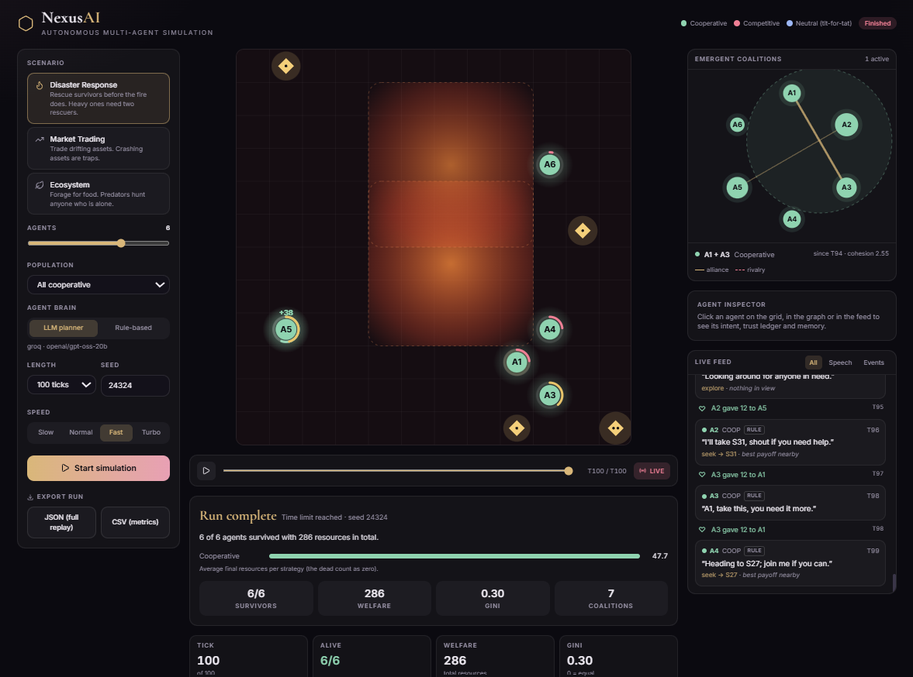
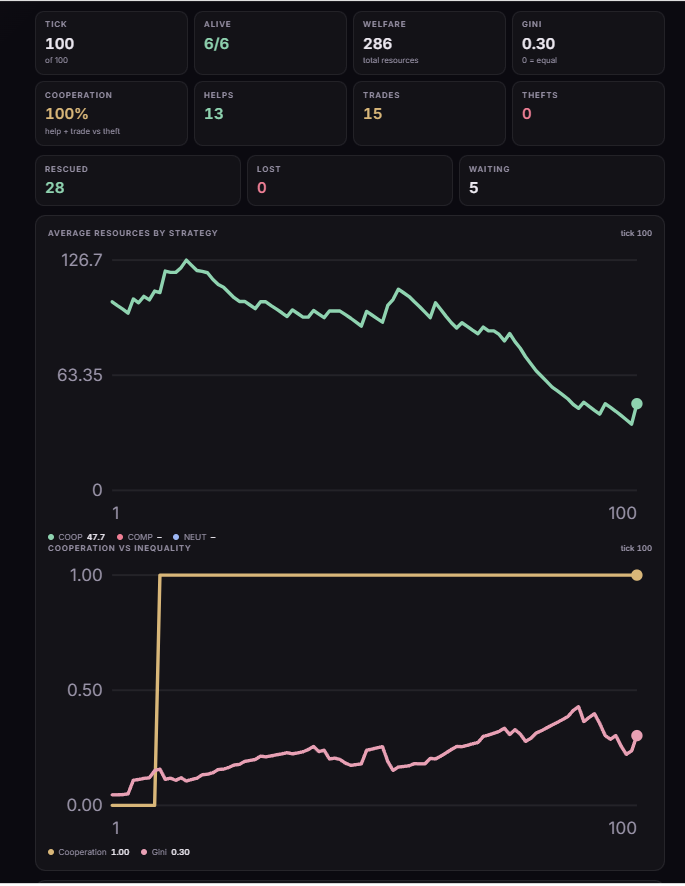

# NexusAI

**A multi-agent simulator for studying when cooperation, theft and alliances emerge between AI agents.**


## Project Overview

Studying how agent strategies (cooperate, compete, retaliate) play out in shared environments normally needs either expensive LLM calls per agent per step or a custom research framework. NexusAI runs up to eight agents in three scenarios (disaster response, market trading, ecosystem survival) on a seeded, deterministic simulator. Agents are driven by a rule-based policy, optionally steered by one batched LLM call every few ticks, and the app detects alliances between agents and reports welfare, inequality and cooperation metrics. It works with no API key and stays within free-tier LLM limits.

## Features

- **Two-speed agents.** An LLM sets each agent's intent (seek, help, trade, steal, follow, explore, rest) every few ticks (6 in the logged run) in one batched call for all agents; a rule controller acts every tick and handles reflexes such as fleeing fire.
- **Free-tier guard rails.** Requests-per-minute and tokens-per-minute budgets, 429 handling, a circuit breaker and silent fallback to the rule policy. In one logged Groq run: 6 calls over 100 ticks.
- **Game-theory mechanics.** Mutual trade is positive-sum (+6 each, only if both pick each other the same tick); theft destroys 20% of the loot and costs reputation; contested nodes cost the loser 3; heavy survivors need two rescuers.
- **Coalition detection.** Decaying alliance and rivalry edges are clustered into groups with formed, reshaped and dissolved events.
- **Three scenarios and five population presets**, including "one wolf among cooperators" and "tit-for-tat versus competitors".
- **Live controls.** Pause, step, change speed, and intervene (resource drain, supply drop, new fire or equivalent crisis) during a run.
- **Replay and export.** Scrub through history, inspect an agent's trust ledger and memory, export JSON or CSV.
- **Deterministic.** The same seed and settings give the same run.
- **Prompt-injection handling.** Messages one agent hears from another are marked untrusted in the planner prompt, sanitised and truncated.

## Tech Stack

| Layer | Tools |
| --- | --- |
| Simulation | Python 3.11+, standard library only |
| API | FastAPI, WebSockets, httpx |
| LLM providers | Groq, Gemini, OpenRouter, Anthropic (one key needed, or none) |
| Frontend | React 19, Vite, Tailwind CSS v4, canvas and SVG charts |
| Tests | pytest (53 tests) |
| Deploy | Vercel (frontend), Render via `render.yaml` or Docker (backend) |

## Screenshots / Demo


*Dashboard at the end of a 100-tick Disaster run: grid, controls, metrics, live feed (6 of 6 agents alive, seed 24324).*


*Coalition graph: alliance edges from repeated help and trade, with the detected group shaded.*


*End-of-run summary: survivors, welfare, Gini, coalitions formed.*


*Average resources by strategy and cooperation versus inequality across 100 ticks, plus the LLM planner status line.*

Live demo: https://nexusai-topaz-three.vercel.app (the backend is on a free plan and sleeps when idle, so the first load can take about a minute)

## Installation

Requires Python 3.11 or newer and Node 20 or newer. Developed on Python 3.12 (Linux) and run on Python 3.14 (Windows). No account is needed; an LLM key is optional.

**Backend**

```bash
# macOS / Linux
cd backend
python3 -m venv venv
source venv/bin/activate
pip install -r requirements-dev.txt
cp .env.example .env
uvicorn main:app --reload --port 8000
```

```powershell
# Windows (PowerShell)
cd backend
python -m venv venv
venv\Scripts\activate
pip install -r requirements-dev.txt
copy .env.example .env
uvicorn main:app --reload --port 8000
```

**Frontend** (second terminal)

```bash
cd frontend
cp .env.example .env      # Windows: copy .env.example .env
npm install
npm run dev
```

Open http://localhost:5173.

**Optional LLM key.** Create a free key at [console.groq.com](https://console.groq.com) (or Google AI Studio for Gemini) and set `GROQ_API_KEY=...` in `backend/.env`. Restart the backend after editing `.env`; uvicorn's reload does not watch it. Free-tier model names change; override with `LLM_MODEL` if a request returns "model not found". Tested model: `openai/gpt-oss-20b` on Groq.

## Usage / Examples

1. Pick a scenario, a population preset, the number of agents, a length and optionally a seed.
2. Choose **LLM planner** (needs a key) or **Rule-based**, then press **Start simulation**.
3. Click an agent to inspect it, use **Intervene** to shock the world, then scrub the timeline and export the run.

Headless example (market scenario, seed 7, balanced mix):

```bash
cd backend
python -m simulation.cli run --scenario market --agents 6 --ticks 100 --seed 7
```

```
survivors: 1 / 6      welfare: 81     cooperation_index: 0.136
helps: 2   trades: 1  steals: 19      coalitions_formed: 1
by_personality: cooperative 0.0, competitive 0.0, neutral 40.5
top_agent: A3 (neutral, 81 resources)
```

Compare presets over many seeds:

```bash
python -m simulation.cli compare --scenario disaster --agents 6 --ticks 100 --seeds 20
```

## Project Structure

```
nexusai/
├── backend/
│   ├── main.py                    # FastAPI app: /health, /api/config, /api/experiment, /ws/{id}
│   ├── config.py                  # provider selection and environment settings
│   ├── requirements.txt           # runtime dependencies
│   ├── requirements-dev.txt       # adds pytest
│   ├── Dockerfile                 # container image for Render/Railway/Fly
│   ├── simulation/
│   │   ├── engine.py              # seeded, phased tick resolution
│   │   ├── agent.py               # agent state, trust ledger, memory
│   │   ├── brain.py               # batched LLM planner with validation
│   │   ├── llm.py                 # multi-provider client, budget, circuit breaker
│   │   ├── policy.py              # rule controller, reflexes, fallback planner
│   │   ├── coalition_detector.py  # alliance and rivalry clustering
│   │   ├── metrics.py             # Gini, cooperation index, welfare
│   │   ├── session.py             # websocket run loop (pause, step, inject)
│   │   ├── experiments.py         # headless batch runs
│   │   ├── cli.py                 # run / compare commands
│   │   ├── constants.py           # payoffs, presets, scenario text
│   │   └── environments/          # disaster.py, market.py, ecosystem.py, base.py
│   └── tests/                     # 53 pytest tests
├── frontend/
│   ├── vercel.json                # Vercel build settings
│   └── src/
│       ├── App.jsx                # layout and shared state
│       ├── components/            # canvas, charts, inspector, feed, replay, controls
│       ├── hooks/useSimSocket.js  # websocket client
│       └── lib/                   # constants, api base URL, export helpers
├── docs/                          # README screenshots
├── render.yaml                    # Render blueprint for the backend
└── LICENSE
```

## Results / Metrics

Mean over 20 seeds (via `simulation.cli compare`), 6 agents, 100 ticks, rule-based policy. Coop = (helps + trades) / (helps + trades + steals). Welfare = total resources of survivors. Disaster rows were measured on Windows (Python 3.14); Market and Ecosystem rows on Linux (Python 3.12).

| Scenario | Population | Alive (of 6) | Welfare | Gini | Coop |
| --- | --- | --- | --- | --- | --- |
| Disaster | All cooperative | 4.1 | 304 | 0.17 | 1.00 |
| Disaster | All competitive | 4.2 | 285 | 0.19 | 0.00 |
| Disaster | One wolf among cooperators | 4.2 | 300 | 0.19 | 0.89 |
| Market | All cooperative | 4.5 | 191 | 0.17 | 1.00 |
| Market | All competitive | 1.6 | 61 | 0.12 | 0.00 |
| Market | One wolf among cooperators | 4.5 | 182 | 0.25 | 0.89 |
| Ecosystem | All cooperative | 4.8 | 279 | 0.26 | 1.00 |
| Ecosystem | All competitive | 3.2 | 154 | 0.25 | 0.00 |
| Ecosystem | One wolf among cooperators | 4.2 | 198 | 0.25 | 0.89 |

What the numbers show:
- Market: all-cooperative welfare is 191 against 61 for all-competitive (3.1x). Ecosystem: 279 against 154 (1.8x).
- Disaster: 304 against 285 (1.07x). After rebalancing rewards (see Challenges) every strategy survives, so cooperation barely pays off in this scenario.
- The lone exploiter does better than its victims (ecosystem: 67 vs 26 average resources; Disaster: 64 vs 47) while group welfare is lower than all-cooperative in Market (182 vs 191) and Ecosystem (198 vs 279).
- LLM planner, one run (Disaster, all cooperative, seed 24324, `openai/gpt-oss-20b`): 6 of 6 survived, 286 total resources, 13 helps, 15 trades, 0 thefts; 6 LLM calls, 32 intents accepted, 4 rejected by validation, 11 planning rounds skipped by the rate budget, average latency 1471 ms.

Limitations: the policies and payoffs are hand-written and hand-tuned, so results describe this simulator, not real agent behaviour. Sample size is 20 seeds per row with no confidence intervals. The LLM planner was tested in one run and not compared against the rule-based policy on the same seed after the Disaster rebalance. Population presets use only three hand-coded personalities.

## Challenges & Learnings

- **Free-tier quotas.** One LLM call per agent per tick is not feasible on a free key. I moved to one batched call for all agents every few ticks, added an RPM/TPM budget and a circuit breaker, and kept a rule policy as fallback. The Groq run above used 6 calls for 100 ticks.
- **Event-loop blocking.** The first design made a synchronous API call inside async code and lost websocket messages with `wait_for`. I switched to an async client and a reader task with a queue.
- **Scenario balance.** The first Disaster setup left 1-2 of 6 agents alive. After tuning, mean survivors rose to 3.8-4.6, but 3 of 40 all-cooperative runs (seeds 0-39) still ended in total extinction. Raising rescue rewards (24 to 34 solo, 30 to 40 team) cut that to 1 of 40, and also erased most of the cooperation advantage in Disaster. Lesson: measure the effect of every balance change across many seeds.
- **Model deprecation.** The default Groq model `llama-3.1-8b-instant` returned HTTP 404 and the first replacement failed JSON validation because reasoning tokens used up the output limit. I switched to `openai/gpt-oss-20b`, added reasoning headroom and a plain-mode retry. Lesson: never hard-code a free-tier model name without an override and a visible error.
- **Determinism.** Seeded RNGs and a fixed phase order (move, trade, help, steal, gather, hazards, metabolism) make runs reproducible, which is what makes the preset comparisons meaningful.
- **Agents as an attack surface.** Agent-to-agent messages are an injection channel, so they are labelled untrusted in the prompt and sanitised.

## Future Improvements

1. Run the LLM planner against the rule-based policy over 20 or more seeds and report the difference with confidence intervals.
2. Re-tune Disaster so that cooperation has a measurable payoff without making extinction common.
3. Add trained agents (Stable Baselines3 or RLlib) in the same environments as a third policy type.
4. Persist experiment results and add shareable run links.
5. Support larger grids and more than eight agents.

## Demo / Live Link

Live demo: https://nexusai-topaz-three.vercel.app

## License

MIT, see [LICENSE](LICENSE).